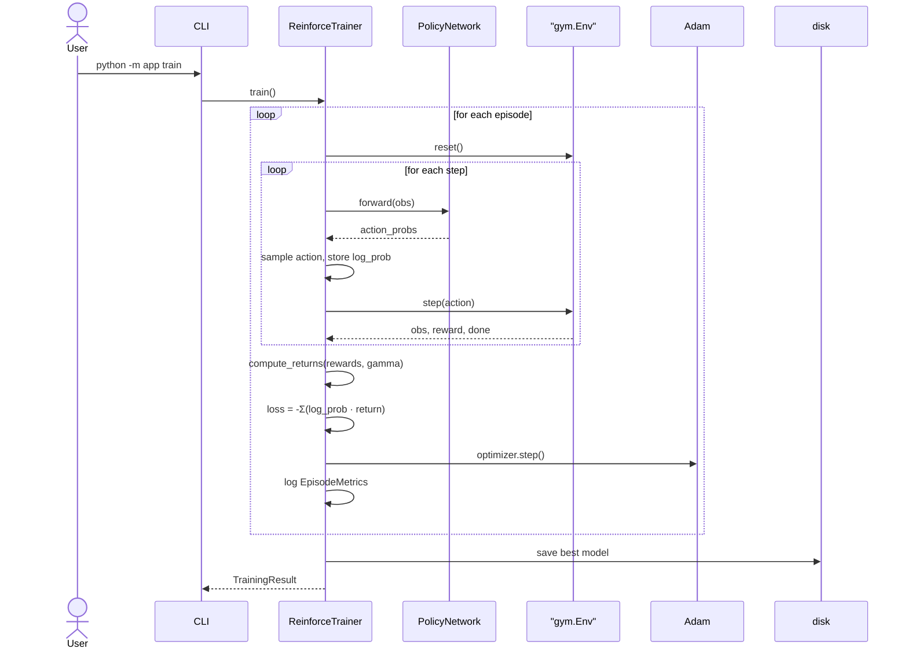

# Feature 007: REINFORCE Training from Scratch

**Branch:** feature/004-episode-management
**Date:** 2026-04-11

---

## Goal

Implement the REINFORCE algorithm (policy gradient) from scratch in PyTorch, integrated with the existing `BaseActionPolicy` interface so trained policies are interchangeable with `RandomActionPolicy` for simulation and replay.

---

## Constraints

- PyTorch only — no external RL libraries
- Must conform to `BaseActionPolicy` (`choose_action(action_space, obs_space) -> int`)
- Training is headless; existing viewer/replay infrastructure handles rendering
- Trained models save/load via PyTorch `state_dict`

---

## Background: How REINFORCE Works

### The RL setup

An **agent** interacts with an **environment** over discrete time steps. At each step `t`:

1. The agent observes a **state** `s_t` (CartPole: a 4-element vector — cart position, cart velocity, pole angle, pole angular velocity)
2. The agent picks an **action** `a_t` from a finite set (CartPole: `{0 = left, 1 = right}`)
3. The environment transitions to `s_{t+1}` and emits a **reward** `r_{t+1}` (CartPole: +1 for every step the pole stays upright)
4. The loop ends when the pole falls, the cart leaves bounds, or the 500-step cap is hit

### The objective: expected return

The total discounted reward over an episode is called the **return**:

```
G_t = r_{t+1} + γ·r_{t+2} + γ²·r_{t+3} + ... + γ^(T-t-1)·r_T
```

`γ ∈ [0, 1)` is the **discount factor** (we use 0.99). It keeps returns finite and makes the agent prefer rewards *now* over rewards later — a reward 100 steps away is worth `0.99^100 ≈ 0.37` of its face value.

The agent's job: maximise the **expected** return, averaged over the randomness of its actions and the environment.

### What REINFORCE learns

REINFORCE learns a **policy** `π_θ(a | s)` directly — a neural network with weights θ that maps a state to a probability distribution over actions. The network's output IS the agent's strategy; there's no intermediate value function.

### The policy gradient theorem

The key result that makes REINFORCE work:

```
∇_θ J(θ) = E[ ∇_θ log π_θ(a_t | s_t) · G_t ]
```

In words:
- `∇_θ log π_θ(a_t | s_t)` is the direction in parameter space that *increases* the probability of action `a_t` at state `s_t`
- `G_t` is the return — how well things went after taking that action
- Multiplied: **move θ to make good actions more likely**, and in the opposite direction for bad ones

This gives a learning rule: sample an episode, compute returns, take a gradient step.

### Why "Monte Carlo"?

REINFORCE waits until an episode ends and uses the **actual observed return** `G_t`. There is no bootstrapping (it never relies on its own future-value estimates during a single update). The return is an unbiased estimate of the true value of `(s_t, a_t)` — but high variance, since a single episode's outcome depends heavily on luck.

### The update step in detail

For each episode `(s_0, a_0, r_1), (s_1, a_1, r_2), ..., (s_{T-1}, a_{T-1}, r_T)`:

1. **Compute returns backwards** (more efficient than forwards):
   ```
   G_{T-1} = r_T
   G_{T-2} = r_{T-1} + γ·G_{T-1}
   ...
   G_t = r_{t+1} + γ·G_{t+1}
   ```

2. **Normalise returns** — subtract the mean and divide by the std across the episode. This is a form of **baseline subtraction**: doesn't change the *expected* gradient, but reduces variance dramatically. Without it, if all returns are positive (e.g., `[100, 101, 102, 103]`), every action gets a positive update — making *all* of them more likely, which doesn't actually distinguish good from bad. After normalisation the returns become something like `[-1.3, -0.4, 0.4, 1.3]`, and the algorithm correctly reinforces the *relatively* better actions.

3. **Compute loss** (negated because PyTorch minimises rather than maximises):
   ```
   loss = -Σ_t log π_θ(a_t | s_t) · G_t
   ```

4. **Backprop and step**: standard PyTorch `loss.backward()`, `optimizer.step()`.

### Exploration is built in

REINFORCE samples actions from the policy's probability distribution. Early in training the policy is near-uniform, so behaviour is exploratory; as training progresses and the policy sharpens, exploration naturally decreases. No ε-schedule, no extra machinery.

### Characteristics

- **On-policy**: each update needs fresh data from the *current* policy. Stale episodes can't be reused because their log-probs no longer match the current network.
- **Episodic**: learning happens at episode end (we need the full return).
- **Simple**: no replay buffer, no target network, no value function.
- **High variance**: training curves are noisy. CartPole REINFORCE typically solves in 500–2000 episodes with wide run-to-run variation.

---

## Module Structure

```
app/
├── training/
│   ├── __init__.py
│   ├── base.py              # BaseTrainer ABC
│   ├── reinforce.py         # ReinforceTrainer
│   └── networks.py          # PolicyNetwork (nn.Module)
├── policy/
│   ├── base.py              # (existing) BaseActionPolicy
│   ├── random.py            # (existing) RandomActionPolicy
│   └── reinforce.py         # ReinforcePolicy (wraps trained PolicyNetwork)
└── models/
    └── training.py          # TrainingConfig, EpisodeMetrics, TrainingResult
```

---

## Components

### `PolicyNetwork` (`app/training/networks.py`)

A 2-hidden-layer MLP:

```
obs (4) → Linear(128) → ReLU → Linear(128) → ReLU → Linear(2) → Softmax → action probabilities
```

Input: a state vector. Output: a probability distribution over actions.

### `ReinforceTrainer` (`app/training/reinforce.py`)

Owns a `PolicyNetwork` and an `Adam` optimizer.

`train()` per episode:
1. Run the policy in the env, recording `(log_prob, reward)` at each step
2. Compute discounted returns `G_t` (backwards)
3. Normalise returns
4. `loss = -Σ log_prob · G_t`
5. `loss.backward()`, `optimizer.step()`
6. Log `EpisodeMetrics`

### `ReinforcePolicy` (`app/policy/reinforce.py`)

Wraps a trained `PolicyNetwork` for use in the existing simulation pipeline. `choose_action()` does a forward pass and samples from the output distribution. `ReinforcePolicy.load(path, ...)` restores from a saved `state_dict`.

### Pydantic models (`app/models/training.py`)

- **`TrainingConfig`** — `num_episodes`, `gamma`, `learning_rate`, `hidden_size`
- **`EpisodeMetrics`** — `episode`, `total_reward`, `steps`, `loss`
- **`TrainingResult`** — `episodes`, `config`, `final_avg_reward`, `solved` (avg ≥ 475 over last 100)

---

## CLI

```
python -m app train --episodes 1000 --lr 0.001
python -m app run-sim --policy reinforce --model-path models/reinforce_best.pt
```

Training saves to `models/reinforce_best.pt`.

---

## Sequence Diagram: Training Loop



---

## Tests

- `test_networks.py` — forward pass shapes, gradient flow, deterministic with seed
- `test_training_models.py` — pydantic config/result construction
- `test_reinforce.py` — return computation, single training step, policy conformance, save/load roundtrip
- `test_training_integration.py` — full train → save → load → run in env

---

## Progress

| Stage | Status |
|-------|--------|
| Models and PolicyNetwork | Done |
| ReinforceTrainer | Done |
| ReinforcePolicy | Done |
| CLI integration | Done |
