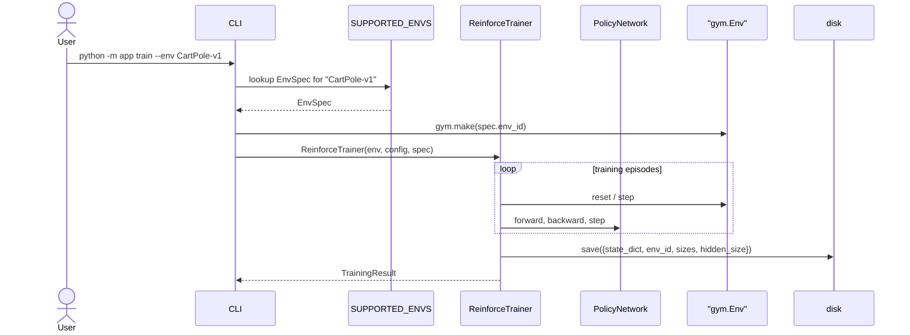

# Feature 008: Generic Environment Support

**Branch:** TBD
**Date:** 2026-04-26

---

## Goal

Decouple the codebase from CartPole-v1 so the same training and simulation pipeline works on any discrete-action Gymnasium environment. The user picks an env via CLI; trained models record which env they came from and refuse to run on a mismatched env.

---

## Constraints

- **Discrete action space only** for now (REINFORCE as written outputs a categorical distribution). Continuous-action envs are out of scope.
- **Box observation space** (vector). Image-input envs (Atari) need a CNN policy and are out of scope.
- Existing tests for CartPole behaviour must still pass after the rename.

---

## Why

Right now CartPole is hardcoded in five places: `CartPoleApp`, `CartPoleViewer`, `app/cli/train.py:ENV_ID`, `app/cli/run_sim.py` constants (`CARTPOLE_OBS_SIZE`, `CARTPOLE_ACTION_SIZE`, `MAX_SIM_SPEED_ALLOWED`), and the `SOLVED_REWARD_THRESHOLD` in `ReinforceTrainer`. Trying any other env requires editing all five. Worse: a model trained on CartPole could silently be loaded against a different env, with no error until the network fails to predict useful actions.

---

## Design overview

Three abstractions:

1. **`EnvSpec`** (Pydantic model) — the metadata that varies per env: `env_id`, physics tick (tau), solved-reward threshold, rolling window for the solved check, default max steps.
2. **`SUPPORTED_ENVS`** (registry) — dict keyed by `env_id` mapping to `EnvSpec`. CLI choices come from this. Initial entries: `CartPole-v1`, `Acrobot-v1`, optionally `LunarLander-v2`.
3. **`BaseEnvApp`** (ABC) and **`GymEnvApp`** (concrete) — replaces `CartPoleApp`. Owns `gym.Env`, `asyncio.Lock`, `_current_obs`. Constructed from an `EnvSpec`. Generic — works for any Gymnasium env.

Then everything that touches CartPole gets parameterised by `EnvSpec` or `BaseEnvApp` instead.

### What replaces what

| Before | After |
|--------|-------|
| `CartPoleApp` (hardcoded `gym.make("CartPole-v1")`) | `BaseEnvApp` ABC + `GymEnvApp(spec: EnvSpec)` |
| `MODEL_TICK_BETWEEN_ACTIONS_S = 0.02` (module-level constant) | `EnvSpec.physics_tick_s` |
| `SOLVED_REWARD_THRESHOLD = 475.0` in trainer | `EnvSpec.solved_reward_threshold` |
| `CARTPOLE_OBS_SIZE = 4`, `CARTPOLE_ACTION_SIZE = 2` in run_sim | Derived from `env.observation_space.shape` and `env.action_space.n` at runtime |
| `CartPoleViewer` | `EnvViewer` (rename — it's already env-agnostic in implementation) |
| `EpisodeRunner.__init__(app: CartPoleApp)` | `EpisodeRunner.__init__(app: BaseEnvApp)` |
| `ENV_ID = "CartPole-v1"` in `cli/train.py` | `--env <id>` CLI flag (required) |
| `torch.save(state_dict, path)` | `torch.save({"state_dict": ..., "env_id": ..., "obs_size": ..., "action_size": ..., "hidden_size": ...}, path)` |

---

## EnvSpec and the registry

```python
class EnvSpec(BaseModel):
    env_id: str                       # gym env id, e.g. "CartPole-v1"
    physics_tick_s: float             # env's tau; CartPole=0.02
    solved_reward_threshold: float    # avg reward over rolling_window to count as "solved"
    rolling_window: int = 100         # episodes for the rolling average
    default_max_steps: int            # cap on episode length for run-sim mode
```

Registry (in a new file `app/models/env.py` or `app/env_registry.py`):

```python
SUPPORTED_ENVS: dict[str, EnvSpec] = {
    "CartPole-v1": EnvSpec(
        env_id="CartPole-v1",
        physics_tick_s=0.02,
        solved_reward_threshold=475.0,
        default_max_steps=500,
    ),
    "Acrobot-v1": EnvSpec(
        env_id="Acrobot-v1",
        physics_tick_s=0.2,                 # Acrobot tau
        solved_reward_threshold=-100.0,     # Acrobot rewards are negative; "solved" = >=−100
        default_max_steps=500,
    ),
    # Optional: "LunarLander-v2" — needs box2d extra
}
```

I'd suggest starting with **CartPole-v1 + Acrobot-v1** for the initial cut, since Acrobot ships with stock gymnasium (no extras), is discrete-action, and exercises a different obs size (6) and action count (3). LunarLander is more interesting but requires `pip install gymnasium[box2d]`.

---

## Module structure changes

```
app/
├── env/                          # NEW
│   ├── __init__.py
│   ├── base.py                   # BaseEnvApp ABC
│   ├── gym_env.py                # GymEnvApp (replaces CartPoleApp)
│   └── registry.py               # EnvSpec + SUPPORTED_ENVS dict
├── cartpole.py                   # DELETED — moved into env/gym_env.py
├── viewer.py                     # CartPoleViewer renamed → EnvViewer
├── cli/
│   ├── run_sim.py                # uses GymEnvApp + EnvSpec; --env required
│   └── train.py                  # --env required; trainer takes EnvSpec
├── models/
│   └── training.py               # TrainingConfig gains env_id field
├── policy/
│   └── reinforce.py              # ReinforcePolicy.load(path) reads env_id from checkpoint
└── training/
    └── reinforce.py              # constants come from EnvSpec, not module-level
```

---

## Component-by-component plan

### 1. `BaseEnvApp` (new)

Abstract interface that `EpisodeRunner` and the rest of the app code against:

```python
class BaseEnvApp(ABC):
    @property
    @abstractmethod
    def env(self) -> gym.Env: ...

    @property
    @abstractmethod
    def lock(self) -> asyncio.Lock: ...

    @property
    @abstractmethod
    def current_obs(self) -> np.ndarray: ...

    @abstractmethod
    def apply_action(self, policy: BaseActionPolicy) -> StepResult: ...

    @abstractmethod
    def reset_env(self) -> None: ...
```

### 2. `GymEnvApp` (new, replaces `CartPoleApp`)

Concrete implementation parameterised by `EnvSpec`:

```python
class GymEnvApp(BaseEnvApp):
    def __init__(self, spec: EnvSpec) -> None:
        self.spec: EnvSpec = spec
        self.env: gym.Env = gym.make(spec.env_id, render_mode="rgb_array")
        self.env.action_space.seed(42)
        self.lock: asyncio.Lock = asyncio.Lock()
        obs, _ = self.env.reset()
        self._current_obs: np.ndarray = obs
    # ...apply_action, reset_env identical to current CartPoleApp
```

### 3. `EpisodeRunner`

Change `__init__(self, app: CartPoleApp)` to `__init__(self, app: BaseEnvApp)`. Body unchanged. The `MODEL_TICK_BETWEEN_ACTIONS_S` constant currently imported from `app.cartpole` becomes `app.spec.physics_tick_s`.

### 4. `ReinforceTrainer`

Take an `EnvSpec` (or just the values) at construction:

```python
def __init__(self, env: gym.Env, config: TrainingConfig, spec: EnvSpec) -> None:
    ...
    self._spec = spec
    # use self._spec.solved_reward_threshold and self._spec.rolling_window
```

Module-level `SOLVED_REWARD_THRESHOLD` and `ROLLING_WINDOW` constants are removed.

### 5. Model checkpoint format

Self-describing dict:

```python
def save_model(self, path: Path) -> None:
    torch.save({
        "state_dict": self._network.state_dict(),
        "env_id": self._spec.env_id,
        "obs_size": <derived>,
        "action_size": <derived>,
        "hidden_size": self._config.hidden_size,
    }, path)
```

Loading verifies env match:

```python
@classmethod
def load(cls, path: Path, expected_env_id: str) -> "ReinforcePolicy":
    checkpoint = torch.load(path, weights_only=False)
    if checkpoint["env_id"] != expected_env_id:
        raise ValueError(
            f"Model was trained on {checkpoint['env_id']}, "
            f"cannot run on {expected_env_id}"
        )
    network = PolicyNetwork(
        obs_size=checkpoint["obs_size"],
        action_size=checkpoint["action_size"],
        hidden_size=checkpoint["hidden_size"],
    )
    network.load_state_dict(checkpoint["state_dict"])
    network.eval()
    return cls(network=network)
```

### 6. CLI changes

**train mode**:

```
python -m app train --env CartPole-v1 --episodes 1000
python -m app train --env Acrobot-v1 --episodes 2000
```

`--env` becomes **required**, `choices=list(SUPPORTED_ENVS)`. Removes the implicit hardcoded CartPole.

**run-sim mode**:

```
python -m app run-sim --env CartPole-v1 --policy reinforce --model-path models/cartpole_best.pt
python -m app run-sim --env Acrobot-v1 --policy random
```

`--env` required. For `--policy reinforce`, `ReinforcePolicy.load(path, expected_env_id=args.env)` will raise if the model was trained on a different env — clear error instead of silent garbage.

Saved-model filename should include the env id by default:
- `models/cartpole-v1_best.pt`
- `models/acrobot-v1_best.pt`

So a single output dir can hold multiple policies without collision.

### 7. Viewer rename

`CartPoleViewer` → `EnvViewer` (mechanical rename, no behaviour change). `ViewerConfig` docstring updated.

### 8. Logging path

`log_file_prefix: str = "logs/cartpole"` in `app/logging_config.py` — change to `"logs/rl-demo"` or similar generic name. Trivial.

---

## What about the existing `models/reinforce_best.pt`?

It's a bare state_dict (old format) — won't have an `env_id`. Two options:

- **Re-train**: simpler. The file is 71 KB; we just regenerate it after merging. The CLI now requires `--env` so this becomes `python -m app train --env CartPole-v1 --episodes 1000`.
- **Backward-compat shim**: `ReinforcePolicy.load` checks if the loaded object is a dict (new format) vs a state_dict (old format) and assumes CartPole-v1 for the old format with a deprecation warning.

I'd go with **re-train** — the model is small, the codebase is young, and a backward-compat shim is permanent debt for a one-time migration.

---

## Tests

New tests:
- `test_env_registry.py` — `SUPPORTED_ENVS` is non-empty, every entry has a valid env_id that gym can instantiate.
- `test_gym_env_app.py` — `GymEnvApp(CartPole-v1)` and `GymEnvApp(Acrobot-v1)` both reset and step correctly. `current_obs` updates after step.
- `test_model_checkpoint_format.py` — save and load roundtrip preserves env_id; load with wrong `expected_env_id` raises `ValueError`.

Update existing tests:
- All `CartPoleApp()` instantiations → `GymEnvApp(SUPPORTED_ENVS["CartPole-v1"])`.
- Trainer tests pass `EnvSpec` explicitly.
- `tests/test_module_separation.py` updates the import paths.

---

## Sequence diagram: train mode (post-refactor)



---

## Implementation stages

| Stage | Description | Approx LOC |
|-------|-------------|-----------|
| 1 | `EnvSpec`, `SUPPORTED_ENVS` registry, tests | ~80 |
| 2 | `BaseEnvApp` ABC + `GymEnvApp`, delete `CartPoleApp` | ~120 |
| 3 | Update `EpisodeRunner` and `ReplayRunner` to use `BaseEnvApp` | ~30 |
| 4 | Generalise `ReinforceTrainer` (drop module-level constants, take spec) | ~40 |
| 5 | Self-describing checkpoint format + env validation on load | ~60 |
| 6 | CLI: `--env` required, plumb through; rename viewer | ~80 |
| 7 | Update tests; re-train and overwrite `models/<env>_best.pt` | ~50 |

Total: ~460 lines, mostly mechanical rename + small additions. About 2–3 commits worth of work.

---

## Open questions for you

Before I start implementing, a few decision points:

1. **Initial supported envs**: CartPole-v1 + Acrobot-v1 (both stock-gymnasium, discrete actions)? Or also add LunarLander-v2 (needs `pip install gymnasium[box2d]` — adds a dep)?

2. **Naming**: I propose `GymEnvApp` and `EnvViewer`. Acceptable, or prefer different names (`EnvApp` + `Viewer`, or keep `CartPoleApp` for backward-compat)?

3. **Model path conventions**: I propose filename includes env id (`cartpole-v1_best.pt`, `acrobot-v1_best.pt`) so a single `models/` dir can hold many. Acceptable, or stay flat with `--output-dir` per env?

4. **Old model file (`models/reinforce_best.pt`)**: Re-train and overwrite, or backward-compat shim? My vote: re-train.

5. **Stages**: Single feature branch with all 7 stages, or split into smaller branches? I'd do single branch — these changes are tightly coupled.
