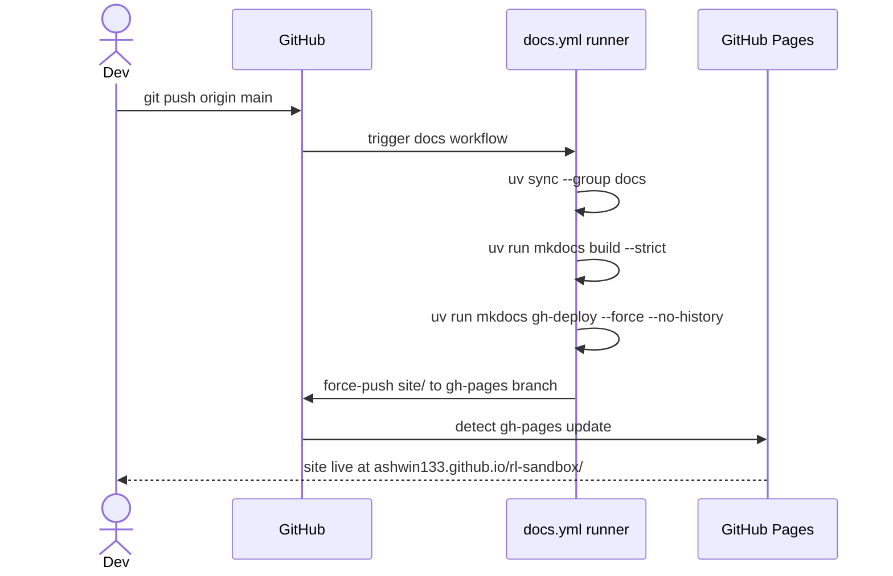

# Feature 010: Public API Documentation Site

**Branch:** `feature/010-api-docs`
**Date:** 2026-05-04

---

## Goal

Publish a browsable API reference for the `rl_sandbox` reinforcement learning algorithm evaluation toolbox at a stable public URL, generated automatically from source docstrings on every push to `main`. The reference must mirror the package's actual module layout, render type-hinted signatures, and be cheap to maintain (no duplicated prose).

---

## Why

Today the only entry points for someone exploring the package are `README.md` (run instructions) and the source itself. There's no overview of the public surface — what classes exist, which subpackages do what, what each function expects. A generated reference solves that and grows automatically as docstrings are added; it also forces a habit of writing docstrings for anything public, which compounds.

We deliberately want **generated-from-source** rather than hand-written API pages: hand-written reference docs drift the moment a signature changes, and we already have the source of truth (type hints + docstrings) in the code.

---

## Constraints

- **No new runtime deps.** Docs deps go into a dedicated `[dependency-groups].docs` group so production installs are unaffected.
- **No behavioural changes to `rl_sandbox/`.** This feature adds tooling, config, a workflow, and project-positioning copy only. Improving API docstrings is a follow-up.
- **Build must succeed in CI without secrets.** The default `GITHUB_TOKEN` (with `contents: write`) suffices for `mkdocs gh-deploy`.
- **Strict build.** `mkdocs build --strict` must pass — broken `:::` references or missing nav targets fail the build.
- Existing `ruff` / `pyrefly` / `pytest` validation pipeline must stay green; docs config files must not introduce lint errors.

---

## Design overview

Three pieces:

1. **MkDocs** — static site generator. Reads `mkdocs.yml`, walks `docs/`, emits `site/`.
2. **mkdocstrings (Python handler)** — MkDocs plugin. Resolves `::: rl_sandbox.<module>` directives by importing the module at build time and rendering its public surface (classes, functions, signatures, docstrings) into HTML.
3. **GitHub Actions + GitHub Pages** — CI workflow runs `mkdocs gh-deploy` on push to `main`, force-pushing built HTML to a `gh-pages` branch which Pages serves at `https://ashwin133.github.io/rl-sandbox/`.

### Why this stack vs. alternatives

| Option | Pros | Cons | Verdict |
|---|---|---|---|
| **MkDocs + mkdocstrings + Material theme** | Markdown (low friction), narrative + auto-API in one site, modern look, small config surface, used by FastAPI/Pydantic/Typer | Slightly less powerful cross-reference than Sphinx | **Chosen** |
| Sphinx + autodoc + ReadTheDocs | Industry standard for PyPI packages; intersphinx links to numpy/torch | RST by default, heavier config, RTD account/setup | Overkill — we don't publish to PyPI |
| pdoc | Zero config, one command | No narrative pages, minimal theming | Too thin — we want a proper site |

---

## Files touched / created

### New

```
mkdocs.yml                                        # MkDocs config + nav + plugin config
docs/
├── index.md                                      # Landing page (mirrors README highlights, links to API)
├── api/
│   ├── cli.md                                    # ::: rl_sandbox.cli.{run_sim,train,playback}
│   ├── envs.md                                   # ::: rl_sandbox.envs.{base,gym_env,registry}
│   ├── episode.md                                # ::: rl_sandbox.episode
│   ├── file_ops.md                               # ::: rl_sandbox.file_ops
│   ├── logging_config.md                         # ::: rl_sandbox.logging_config
│   ├── models.md                                 # ::: rl_sandbox.models.{batch,episode,recording,replay,training}
│   ├── plot.md                                   # ::: rl_sandbox.plot
│   ├── policy.md                                 # ::: rl_sandbox.policy.{base,random,reinforce}
│   ├── render.md                                 # ::: rl_sandbox.render
│   ├── replay.md                                 # ::: rl_sandbox.replay
│   ├── training.md                               # ::: rl_sandbox.training.{base,checkpoint,networks,reinforce}
│   ├── utilities.md                              # ::: rl_sandbox.utilities
│   └── viewer.md                                 # ::: rl_sandbox.viewer
.github/workflows/docs.yml                        # Build + gh-deploy on push to main
```

### Modified

```
pyproject.toml                                    # add [dependency-groups].docs
README.md                                         # add docs site link near the top
.gitignore                                        # add /site/ (mkdocs build output)
.ai_agents/task.md                                # log Feature 010
.ai_agents/understanding.md                       # add docs subsystem note
rl_sandbox/__init__.py                            # package-level toolbox description
rl_sandbox/__main__.py                            # toolbox-focused CLI description
rl_sandbox/envs/gym_env.py                        # remove stale CartPole replacement wording
```

### Behaviour unchanged

- The `rl_sandbox` edits are descriptions only; training, simulation, replay, and persistence behaviour is unchanged. Broader docstring improvements remain a follow-up.

---

## `mkdocs.yml` shape

```yaml
site_name: rl-sandbox
site_description: A toolbox for training, evaluating, and comparing reinforcement learning algorithms
site_url: https://ashwin133.github.io/rl-sandbox/
repo_url: https://github.com/ashwin133/rl-sandbox
repo_name: ashwin133/rl-sandbox
edit_uri: edit/main/docs/

theme:
  name: material
  features:
    - navigation.sections
    - navigation.expand
    - content.code.copy
    - search.suggest
  palette:
    - scheme: default
      primary: indigo
    - scheme: slate
      primary: indigo

plugins:
  - search
  - mkdocstrings:
      handlers:
        python:
          paths: [.]
          options:
            docstring_style: google
            show_source: true
            show_signature_annotations: true
            separate_signature: true
            members_order: source
            heading_level: 2
            filters: ["!^_"]            # hide private members

nav:
  - Home: index.md
  - API:
      - CLI: api/cli.md
      - Envs: api/envs.md
      - Episode: api/episode.md
      - File ops: api/file_ops.md
      - Logging: api/logging_config.md
      - Models: api/models.md
      - Plot: api/plot.md
      - Policy: api/policy.md
      - Render: api/render.md
      - Replay: api/replay.md
      - Training: api/training.md
      - Utilities: api/utilities.md
      - Viewer: api/viewer.md
```

Docstring style is set to **google** because that's what existing code uses (e.g., `ReinforcePolicy.load`'s docstring is a single-line summary; google handler degrades cleanly when sections are absent).

---

## `pyproject.toml` change

```toml
[dependency-groups]
dev = [
    "pyrefly>=0.59.1",
    "pytest>=9.0.2",
    "ruff>=0.15.7",
]
docs = [
    "mkdocs>=1.6",
    "mkdocs-material>=9.5",
    "mkdocstrings[python]>=0.27",
]
```

Kept separate from `dev` so contributors who don't touch docs can `uv sync` without pulling in the docs toolchain. CI installs both groups when needed.

---

## `.github/workflows/docs.yml`

```yaml
name: docs

on:
  push:
    branches: [main]
  workflow_dispatch:

permissions:
  contents: write   # needed to push to gh-pages

concurrency:
  group: docs
  cancel-in-progress: true

jobs:
  deploy:
    runs-on: ubuntu-latest
    steps:
      - uses: actions/checkout@v4
        with:
          fetch-depth: 0     # gh-deploy needs full history to push to gh-pages
      - uses: astral-sh/setup-uv@v6
        with:
          enable-cache: true
      - name: Sync env (project + docs group)
        run: uv sync --group docs
      - name: Build (strict)
        run: uv run mkdocs build --strict
      - name: Deploy to gh-pages
        run: uv run mkdocs gh-deploy --remote-branch gh-pages --force --no-history
```

Notes:
- `--strict` runs first as a separate step so a broken cross-reference fails CI before we touch the live branch.
- `concurrency.cancel-in-progress: true` avoids racing deploys when commits land in quick succession.
- `--remote-branch gh-pages` makes the deployment target explicit rather than relying on MkDocs' default.
- `--no-history` keeps the `gh-pages` branch lean (single commit, not a growing log of build snapshots).

### One-time post-merge step (manual)

After the first successful deploy, in repo Settings → Pages, set Source = **Deploy from a branch** → branch `gh-pages` / folder `/ (root)`. This is a GitHub UI step that can't be done via the workflow on first run; documented in `.ai_agents/task.md` as a follow-up action.

---

## Docstring posture

Currently most modules have terse one-line docstrings (e.g. `rl_sandbox/policy/reinforce.py:1` `"""REINFORCE policy — wraps a trained PolicyNetwork as a BaseActionPolicy."""`). mkdocstrings will render whatever's there — type hints carry most of the signal, and short docstrings are still useful as headings.

**Out of scope for this feature**: a docstring-improvement pass. That's a separate, larger task — once the site exists, gaps become visible and can be filled iteratively.

---

## Tests

Docs tooling is config + Markdown — no runtime code to unit-test. Coverage comes from:

1. **`mkdocs build --strict` in CI**. This catches:
   - Broken `:::` directives (module/symbol doesn't import or doesn't exist).
   - Missing nav targets.
   - Broken internal links.
   - Markdown that the renderer chokes on.
2. **One smoke test** (optional, low value — debating): `tests/test_docs_build.py` that shells out to `mkdocs build --strict` and asserts exit 0. Adds a hard dep on docs being present in the test env. **Recommendation: skip.** CI already runs `--strict`; duplicating that as a unit test slows local `pytest` for marginal gain.

The validation pipeline (`ruff format` → `ruff check` → `pyrefly` → `pytest`) is unaffected — this feature touches no `.py` files in `rl_sandbox/` or `tests/`.

---

## Implementation stages

| Stage | Description | Approx LOC | Commit? |
|---|---|---|---|
| 1 | Add `[dependency-groups].docs` to `pyproject.toml`, write `mkdocs.yml`, create `docs/index.md` and one auto-rendered API page (`docs/api/policy.md`). Verify `uv run mkdocs build --strict` passes locally. Add `/site/` to `.gitignore`. | ~80 | ✅ |
| 2 | Author the remaining `docs/api/*.md` pages and wire them into the nav. Re-run `mkdocs build --strict`. | ~60 | ✅ |
| 3 | Add `.github/workflows/docs.yml`. Verify YAML lints. (Live deploy only triggers post-merge to main.) | ~25 | ✅ |
| 4 | Add docs URL to `README.md`. Update `.ai_agents/task.md` (log feature 010) and `.ai_agents/understanding.md` (mention docs subsystem and `gh-pages` branch). | ~20 | ✅ |

Total: ~185 lines, all config/Markdown. Each stage is independently testable.

---

## Risks & mitigations

| Risk | Mitigation |
|---|---|
| `mkdocstrings` import-time failures (e.g., `pygame` requires display in some envs) | `paths: [.]` + `uv sync --group docs` installs the package; CI runners are headless but `pygame` import doesn't open a display. If it breaks, scope `filters` per page or stub via `mkdocs_gen_files`. Watch for this in stage 1. |
| `gh-pages` branch doesn't exist on first run | `mkdocs gh-deploy` creates it on first push. Manual Settings → Pages step required afterwards (logged in task.md). |
| Strict build fails on private-name references | `filters: ["!^_"]` excludes underscore-prefixed members. Adjust per-page if needed. |
| `torch` import overhead in CI | Already paid by `pytest` in the existing CI; no additional cost. |

---

## Sequence diagram: push-to-deploy



---

## Implementation decisions

The implementation request approved the proposed defaults: the repository-derived GitHub Pages URL, Material theme, Google-style docstrings, full module coverage, strict-build verification in CI rather than a pytest subprocess, and a concise toolbox-focused landing page.

---

## Progress

_Updated as stages complete._

- [x] Stage 1 — deps + mkdocs.yml + docs skeleton
- [x] Stage 2 — full API page coverage
- [x] Stage 3 — GitHub Pages workflow
- [x] Stage 4 — README + .ai_agents updates
- [x] Final validation — `ruff format`, `ruff check`, Pyrefly, 140 tests, and strict MkDocs build pass (2026-08-03)
